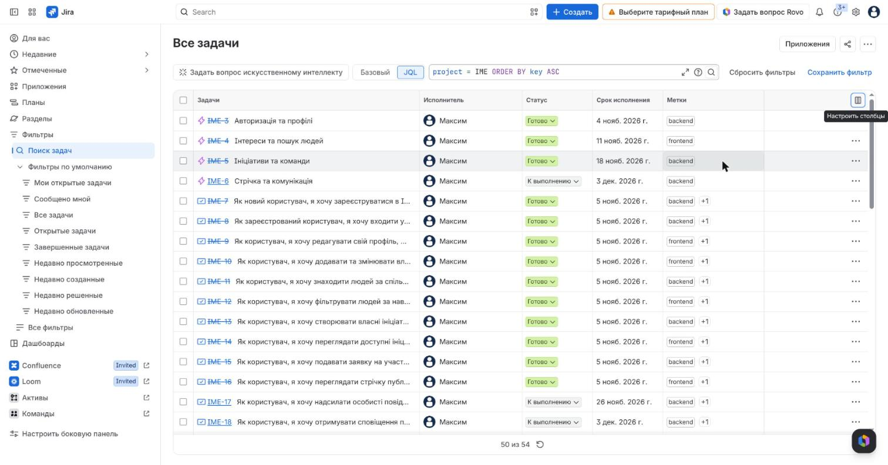
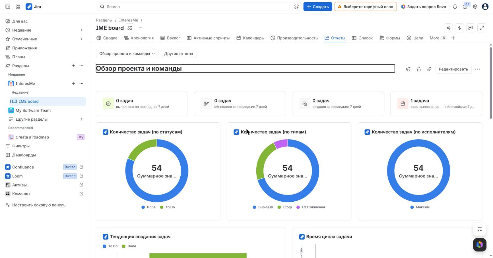
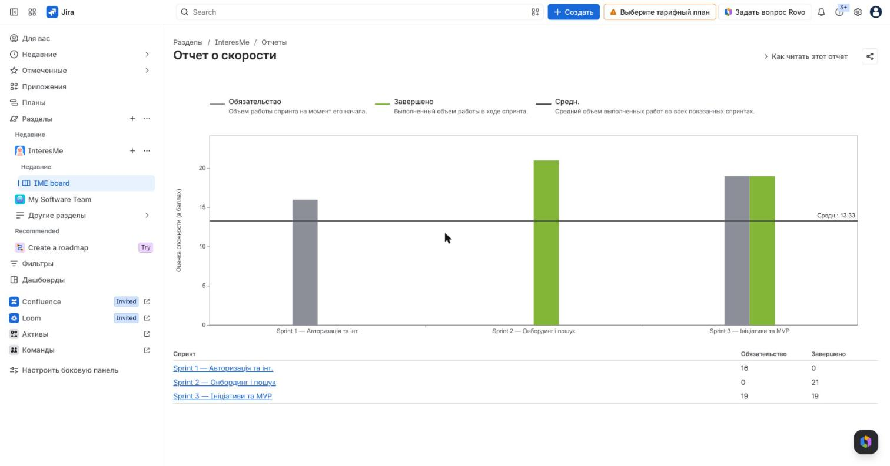
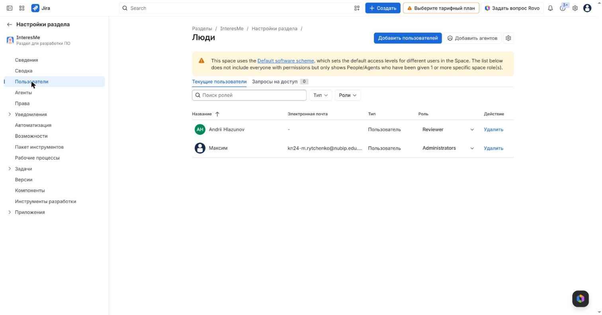
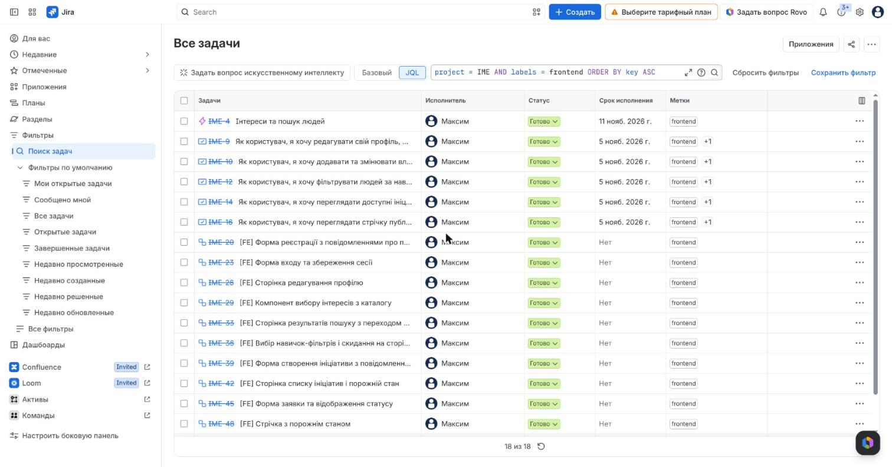

# Лабораторна робота №6
## Управління ресурсами в Jira

**Проєкт:** InteresMe | **Ключ Jira-проєкту:** `IME` ([дошка](https://nubip-team-u9qon6a8.atlassian.net/jira/software/c/projects/IME/boards/2)) | **Дата отримання даних:** 25.11.2026

**Мета роботи:** визначити зони відповідальності та Area Leads, класифікувати задачі Jira за Labels, оцінити доступність і компетенції команди, розрахувати Capacity і Workload та скласти ресурсний план на наступні спринти.

> **Важлива обставина.** InteresMe виконується **одноосібно** (див. [`README.md`](../README.md), [`jira-setup.md`](../jira-setup.md)). Проєкт має одного виконавця — Максима. Andrii Hlazunov є викладачем із роллю `Reviewer`, а не учасником розробки. У лабораторній не створювалися фіктивні учасники, тому аналіз Skills Matrix, Bus Factor і Workload виконано для єдиного учасника, а вирівнювання між людьми неможливе (розділ 2.7).
>
> Усі дані про Jira отримано з проєкту `IME` через інтерфейс і REST API (сесія браузера) та повторно перевірено JQL-запитами в інтерфейсі. Показники доступності та компетенцій — **планові оцінки автора, що потребують його підтвердження** (джерело: [`project-classification.md`](../project-classification.md), [`time-cost-plan.md`](time-cost-plan.md)).

---

## 2.1. Склад команди

| Учасник | Ролі в проєкті | Доступність (FTE) | Годин на тиждень |
|---|---|---:|---:|
| Максим (власник Jira-проєкту, роль Administrator) | PM / Team Lead, Product Owner, Developer (backend + frontend), QA, Designer, Analyst | 0,50 | 20 |
| **Разом по команді** | | **0,50** | **20** |

`FTE = 20 ÷ 40 = 0,50`. Значення 20 год/тиж — верхня межа з аналізу оточення (ЛР №2: «15–20 годин на тиждень») і те саме, що закладено в Time Tracking Jira та ЛР №5 (4 год × 5 днів). Чутливість до нижньої межі (15 год) наведено в п. 2.2.

Ролі доступу в Jira (перевірено): `Максим` — Administrators; `Andrii Hlazunov` — Reviewer (викладач, не виконавець). Інших користувачів із доступом немає.

---

## 2.2. Capacity на спринт

| Параметр | Значення | Коментар |
|---|---|---|
| Тривалість спринту | 2 тижні (14 днів) | Sprint 4: 19.11–03.12.2026 (за Jira) |
| Σ годин команди на спринт | 40 год | 20 год/тиж × 2 тиж |
| Коефіцієнт непродуктивного часу | −20% | мітинги, планування, review, координація |
| Ефективна Capacity | **32 год** | 40 × 0,8 |
| Velocity (факт, Sprint 3) | **19 SP** | Velocity Report: Commitment 19, Completed 19 |
| Годин на 1 SP | **1,68 год** | 32 ÷ 19 = 1,684 |
| Плановий обсяг наступного спринту | **19 SP** | ⌊32 ÷ 1,684⌋ = 19 |

Розрахунок: `Nominal = 20 × 2 = 40 год`; `Effective = 40 × 0,8 = 32 год`; `Hours/SP = 32 ÷ 19 = 1,684`; `Planned SP = ⌊32 ÷ 1,684⌋ = 19`.

**Застереження щодо методу.** Capacity Sprint 3 приймається рівною поточній (історичних даних про фактичну доступність немає), тому плановий обсяг за формулою збігається з Velocity Sprint 3 за побудовою. Це припущення, а не незалежне підтвердження. Годин на SP за Original Estimate (ЛР №5) дає інше значення — 2,0 год/SP (106 год ÷ 53 SP); у цій роботі використано метод із завдання (за Velocity).

**Чутливість (15 год/тиж):** Nominal 30 год, Effective 24 год, Hours/SP = 24 ÷ 19 = 1,26. Original Estimate Sprint 4 (26 год) тоді перевищує Capacity (108%).

Історія Velocity з Jira:

| Спринт | Commitment | Completed | Примітка |
|---|---:|---:|---|
| Sprint 1 (21.10–04.11) | 16 | 0 | закрито без виконаних Stories |
| Sprint 2 | 0 | 21 | Stories додано після старту, тому Commitment = 0 |
| Sprint 3 | 19 | 19 | останній завершений спринт |

Середня в Jira — 13,33 SP; робоча (S2–S3) — 20,0 SP. Історичні дані не змінювались.

---

## 2.3. Skills Matrix

Шкала: 0 — немає, 1 — базовий, 2 — впевнений, 3 — сильний (самостійно + review). Оцінки **попередні**: засновані на документованому досвіді (ЛР №2), виконаних задачах (Sprint 2–3, 80 інтеграційних тестів, 17 unit-тестів Angular, CI) і потребують підтвердження автором.

| Навичка | Максим | Потрібний рівень | Учасників ≥ потрібного | Ризик (за правилом завдання) |
|---|---:|---:|---:|---|
| Frontend (Angular, TypeScript, Tailwind) | 2 | ≥2 | 1 | середній |
| Backend (ASP.NET Core, REST, JWT/OAuth) | 2 | ≥2 | 1 | середній |
| Бази даних (PostgreSQL, EF Core) | 2 | ≥2 | 1 | середній |
| Тестування (xUnit/інтеграційні, Angular unit) | 2 | ≥1 | 1 | середній |
| DevOps / Деплой (Docker, GitHub Actions) | 2 | ≥1 | 1 | середній |
| Дизайн / UX (макети) | 1 | ≥1 | 1 | середній |
| Git / Code Review | 2 | ≥2 | 1 | середній (немає незалежного reviewer) |

Високий ризик (жодного учасника з потрібним рівнем) формально відсутній, але «середній» тут означає **єдину точку відмови** у кожній навичці.

## 2.4. Аналіз Skills Matrix

| Питання | Відповідь |
|---|---|
| Яка навичка покрита лише однією людиною? | Усі сім; команда з одного учасника. |
| Який Bus Factor у критичних зонах? | backend = 1, frontend = 1, qa = 1, design = 1, infra = 1 (немає окремих задач, зона не створювалась). Загальний Bus Factor проєкту = **1** (метод: кількість людей, здатних самостійно підтримувати зону з доступом і знаннями про реалізацію; оцінка 2 не вважається повною взаємозамінністю). |
| Яка навичка потрібна, але слабка? | Дизайн/UX (рівень 1, обмежене підтвердження) і незалежний code review (потребує другої особи). |
| Що буде, якщо Area Lead недоступний? | Усі зони зупиняються: заміни немає, Sprint 4 (13 SP) не буде виконано. |
| План закриття розриву | Таблиця нижче. |

| Навичка | Хто навчається | Хто допомагає | Практичне завдання | Спринт | Критерій успіху |
|---|---|---|---|---|---|
| Code Review / Bus Factor | Максим | Рецензент із групи (**потребує погодження**) | Передати PR зі Sprint 4 на незалежний review | Sprint 4 | ≥1 PR перевірено другою особою |
| Backend / DB | Резервний виконавець (за наявності) | Максим | Runbook: запуск API, міграції, seed, CI | Sprint 4 | Нова людина піднімає проєкт за документом |
| Frontend | Резервний виконавець | Максим | Описати архітектуру `interesme-web`, додати одну малу задачу | Sprint 5 | Merge малої задачі без допомоги |
| Дизайн | Максим | Викладач/однокурсник (оцінка макетів) | IME-51 «Макет списку чатів» із фідбеком | Sprint 4 | Макет затверджено до реалізації IME-52 |
| Тестування | Максим | CI | Тести IME-53/IME-56 у CI | Sprint 4 | Тести зелені в GitHub Actions |

Без другої людини реальне зниження Bus Factor неможливе; перелічені кроки лише зменшують ризик документацією та автоматизацією.

---

## 2.5. Зони відповідальності

Правило: **кожна Story, Task і Subtask має рівно один Label технічної зони**; службові `must-have`/`should-have`/`could-have` збережено. Основну зону Story обрано за змістом Acceptance Criteria (де зосереджена основна логіка), Subtasks — за префіксом `[BE]/[FE]/[QA]/[Design]` власної назви. Epics класифіковано за зоною більшості їхніх Stories (потрібно, щоб `labels is EMPTY` давав 0).

| Label | Area Lead | Кількість задач | Що входить |
|---|---|---:|---|
| `backend` | Максим | 22 | 12 Subtasks `[BE]`, Stories IME-7, 8, 11, 13, 15, 17, 18, Epics IME-3, 5, 6 |
| `frontend` | Максим | 18 | 12 Subtasks `[FE]`, Stories IME-9, 10, 12, 14, 16, Epic IME-4 |
| `qa` | Максим | 12 | 12 Subtasks `[QA]` |
| `design` | Максим | 2 | `[Design]` IME-32, IME-51 |
| `infra` | — | 0 | Зону не створено штучно: у беклозі немає задач CI/деплою. Допустима для наступних спринтів. |
| **Разом** | | **54** | 4 Epics + 12 Stories + 38 Subtasks |

Area Lead для всіх зон — Максим: єдиний учасник.

**JQL-перевірки (25.11.2026, інтерфейс Jira):**

| JQL | Результат |
|---|---:|
| `project = IME AND labels is EMPTY` | 0 |
| `project = IME AND (labels is EMPTY OR labels not in (backend, frontend, qa, infra, design))` | 0 |
| `labels = backend` / `frontend` / `qa` / `design` / `infra` | 22 / 18 / 12 / 2 / 0 |
| усі 6 пар зон `labels = A AND labels = B` | 0 |
| `project = IME AND assignee is EMPTY` | 0 |

Сума по зонах 22 + 18 + 12 + 2 = 54 = усі задачі проєкту. Програмна перевірка масивів Labels: у кожної з 54 задач рівно одна технічна зона.

---

## 2.6. Аналіз Workload

Активного спринту немає (Sprint 3 закрито, Sprint 4 у стані «future», хоча планова дата старту 19.11 минула). Тому поточний обсяг береться з підготовленого Sprint 4, а `Completion Rate` — із завершених спринтів (кожен показник з одного спринту).

| Учасник | Спринт | Задач | SP committed | SP done | % виконання | Висновок |
|---|---|---:|---:|---:|---:|---|
| Максим | Sprint 1 (21.10–04.11) | 4 Stories | 16 | 0 | 0% | перше планування без декомпозиції |
| Максим | Sprint 2 | 5 Stories | 0 (додано після старту) | 21 | N/A | Commitment = 0 у Jira |
| Максим | Sprint 3 (останній завершений) | 5 Stories | 19 | 19 | **100%** | стабільна Velocity |
| Максим | **Sprint 4 (план, не стартував)** | 2 Stories + 7 Subtasks | 13 | 0 | — | див. нижче |

Оскільки виконавець один (усі 54 задачі — Максим), розподіл між людьми тривіальний; Story Points Stories та Subtasks не підсумовуються повторно (SP стоять лише на Stories, Subtasks мають лише Original Estimate).

**Sprint 4 за зонами:** backend 4, frontend 2, qa 2, design 1 (9 задач: IME-17, 18, 50–56). Статуси: усі To Do.

| Показник Sprint 4 | Значення |
|---|---|
| SP | 13 |
| Estimated hours за Hours/SP | 13 × 1,684 = 21,9 год |
| Utilization | 21,9 ÷ 32 = **68%** |
| Original Estimate Subtasks (Jira) | 26 год → 26 ÷ 32 = **81%** |
| При 15 год/тиж (Effective 24 год) | 26 ÷ 24 = 108% — перевантаження |

Критична зона — backend (IME-17 приватні повідомлення, 8 SP, найскладніша історія з вимогою приватності діалогів).

**Time Tracking** (увімкнено, 4 год/день, 5 днів/тиж): усього 31 worklog, 53 хв, усі від автора Максим, період 05.11.2026 10:50–12:03 (Sprint 2: 17 хв, Sprint 3: 36 хв). Як зазначено в ЛР №5, це машинний час сесії AI-агентів, тому порівнювати його з доступністю 20 год/тиж некоректно. Worklogs не створювались і не змінювались.

---

## 2.7. Вирівнювання завантаження

| Виявлена проблема | Рішення | Результат |
|---|---|---|
| Дисбаланс між учасниками | Не застосовується: один виконавець, усі задачі закріплено за ним | Перепризначень немає |
| Незавершені задачі без Assignee | `assignee is EMPTY` → 0 | Змін не потрібно |
| Єдина точка відмови (Bus Factor = 1) | Заходи з п. 2.4 | Потребує другої людини |
| Sprint 4 при 15 год/тиж не вміщується (108%) | Не змінювались SP/спринти; ризик зафіксовано; за потреби винести IME-18 (5 SP) у Sprint 5 | Рішення за PO у момент старту |
| Спринт «Sprint 4» не запущено | Не запускався автоматично: це змінює плани та історію | Запустити вручну з оновленими датами |

Перепризначення не виконувались: вигадувати учасників для вирівнювання заборонено, а передавати задачі викладачу (Reviewer) неприпустимо. Default assignee перевірено — вже встановлено **«Владелец раздела»** (Максим), `assigneeType = PROJECT_LEAD`; змін не вносилось.

---

## 2.8. Ресурсний план по спринтах

| Спринт | Період | Потрібні зони | Capacity (год) | План SP | Особливості |
|---|---|---|---:|---:|---|
| Sprint 4 — Комунікація (v1.1) | 19.11–03.12.2026 (Jira, **ще не запущено**) | backend, frontend, qa, design | 32 | 13 з 19 (резерв 6 SP) | IME-17, 18; 26 год Original Estimate; потрібні нові дати старту |
| Sprint 5 (прогноз, **не створено в Jira**) | 03.12–17.12.2026 | залежить від беклогу | 32 | до 19 (задач немає) | Беклог порожній після Sprint 4; потрібні нові Stories від PO; можлива зимова сесія — **потребує підтвердження** |

Дати Sprint 5 — прогнозні послідовні, не встановлені в Jira. Capacity враховує 20% непродуктивного часу.

---

## 2.9. Скріншоти Jira

| № | Що на скріншоті | Файл |
|:-:|---|---|
| 1 | Список усіх задач IME із Labels | [img/lab9-labels.png](img/lab9-labels.png) |
| 2 | Розподіл задач за виконавцями (звіт «Обзор проекта и команды») | [img/lab9-workload.png](img/lab9-workload.png) |
| 3 | Velocity report | [img/lab9-velocity.png](img/lab9-velocity.png) |
| 4 | Details → Default assignee | [img/lab9-default-assignee.png](img/lab9-default-assignee.png) |
| 5 | Sprint burndown (Sprint 3) | [img/lab9-burndown.png](img/lab9-burndown.png) |
| 6 | Access (люди та ролі) | [img/lab9-access.png](img/lab9-access.png) |
| 7 | JQL Validation `labels is EMPTY` | [img/lab9-labels-validation.png](img/lab9-labels-validation.png) |
| 8–11 | Задачі зон backend / frontend / qa / design | [backend](img/lab9-backend.png), [frontend](img/lab9-frontend.png), [qa](img/lab9-qa.png), [design](img/lab9-design.png) |

**Відхилення від методички.** `lab9-areas.png` (Board, Group by Labels) не створено: активного спринту немає, тому дошка порожня, а групування списку за Labels показує лише Epics. Замість нього надано чотири скріншоти JQL по зонах із лічильниками (22/18/12/2). Скріншот Backlog замінено списком задач із колонкою «Метки», бо Backlog містить лише Sprint 4. Знімки Jira використовують російськомовний інтерфейс акаунта.

Рис. 1. Усі задачі проєкту з технічними Labels (50 з 54 на екрані).

Рис. 2. Усі 54 задачі закріплено за Максимом.

Рис. 3. Velocity: Sprint 1 — 16/0, Sprint 2 — 0/21, Sprint 3 — 19/19.

Рис. 4. Default assignee = власник розділу.

Рис. 5. Burndown Sprint 3 (19 SP).

Рис. 6. Максим — Administrators, Andrii Hlazunov — Reviewer.

Рис. 7. `project = IME AND labels is EMPTY` — 0 задач.

Рис. 8. Зона backend — 22 задачі.

Рис. 9. Зона frontend — 18 задач.

Рис. 10. Зона qa — 12 задач.

Рис. 11. Зона design — 2 задачі.

---

## 2.10. Висновки команди

1. **Перевантаження.** Один виконавець; Sprint 4 завантажує його на 68% (за Hours/SP) або 81% (за Original Estimate) від 32 год. При доступності 15 год/тиж — 108%, тобто перевантаження можливе. Недовантажених немає.
2. **Bus Factor = 1** у всіх зонах. Підвищити його можна лише залученням другої людини; до цього — runbook, CI-тести та передача одного PR на незалежний review.
3. **Реалістичність SP.** 13 SP у Sprint 4 нижче за Velocity 19 SP і вкладається в Capacity 32 год за прийнятих припущень. Прогноз «19 SP» методологічно збігається з минулою Velocity.
4. **Найбільша зона** — backend (22 задачі, 41%), далі frontend (18), qa (12), design (2).
5. **Відповідність компетенціям.** Розподіл формально відповідає (один виконавець із рівнем ≥2 у ключових навичках), але слабка зона — дизайн (рівень 1).
6. **Зміни в Jira.** Додано по одному Label зони всім 54 задачам (`backend` 22, `frontend` 18, `qa` 12, `design` 2); службові Labels збережено. Assignee, статуси, SP, Worklogs, спринти, Default assignee та Access **не змінювались**.
7. **Рішення для наступних спринтів:** запустити Sprint 4 з актуальними датами; погодити рецензента; підтвердити фактичну доступність (15 чи 20 год/тиж) і попередні оцінки Skills Matrix; створити Stories для Sprint 5 і за потреби зону `infra`.

---

## Обмеження та відкриті питання

- Доступність (20 год/тиж) і рівні компетенцій — **не результат опитування команди**, а оцінки автора за документацією; потребують підтвердження.
- Немає історичних даних про фактичну доступність за Sprint 1–3.
- Активного спринту немає, тому Board за Assignee/Labels порожня; використано списки та звіти.
- Sprint 5 відсутній у Jira, його період — прогноз.
