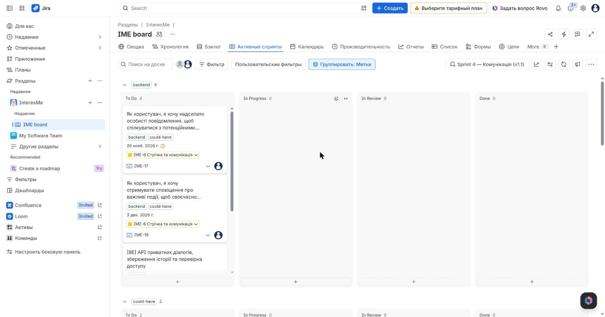
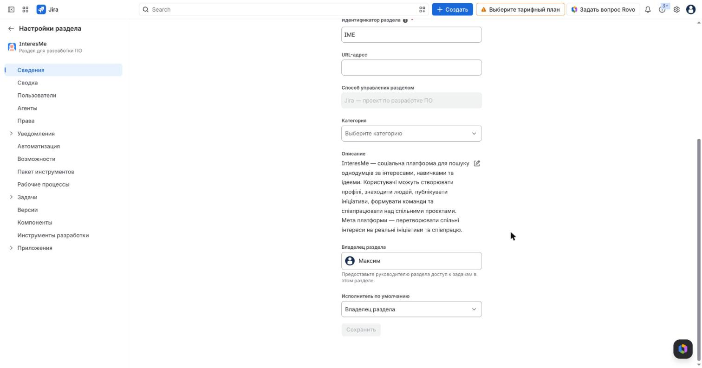
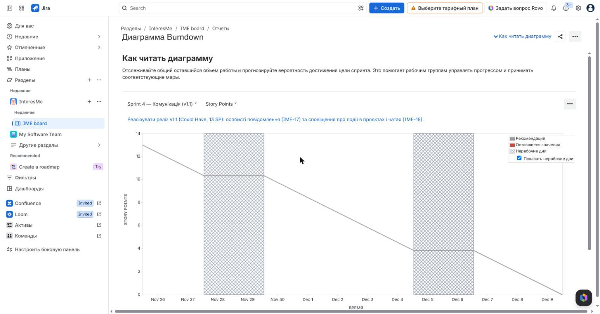
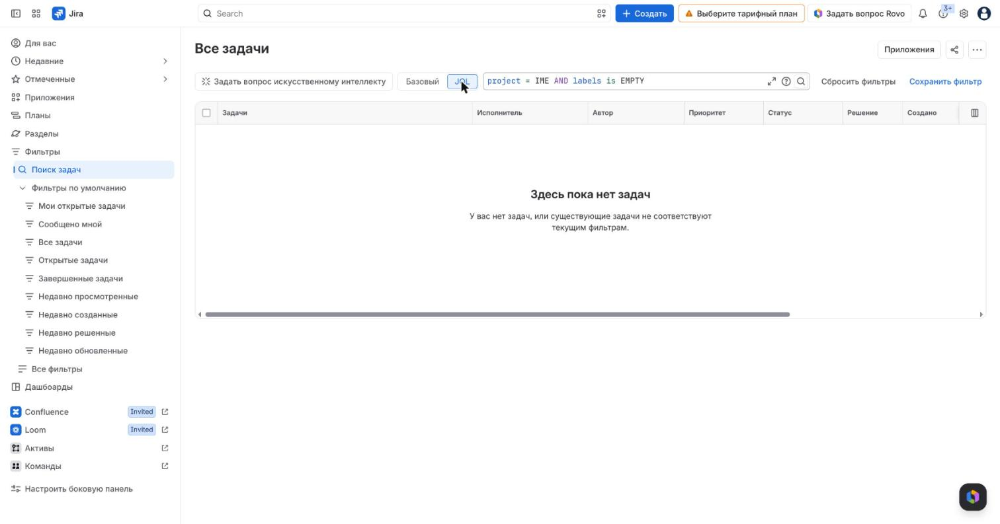
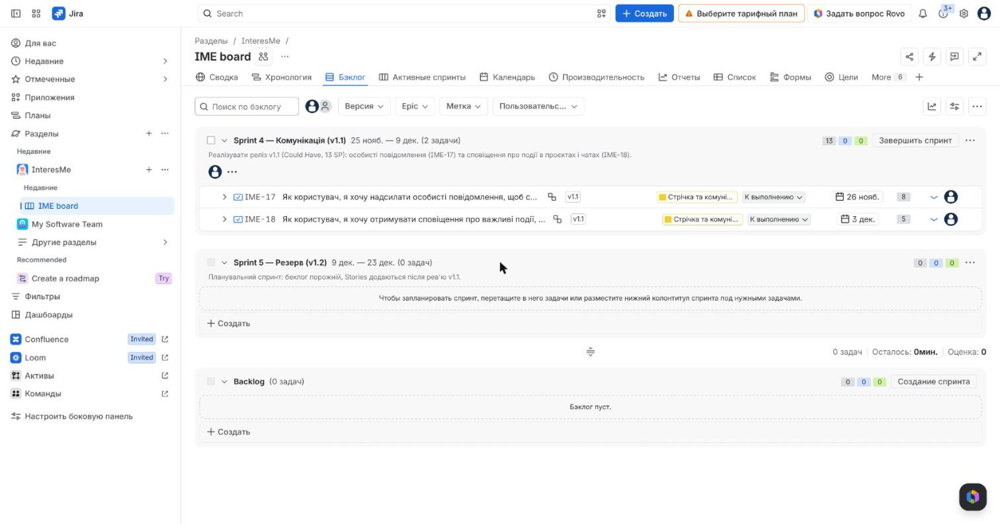
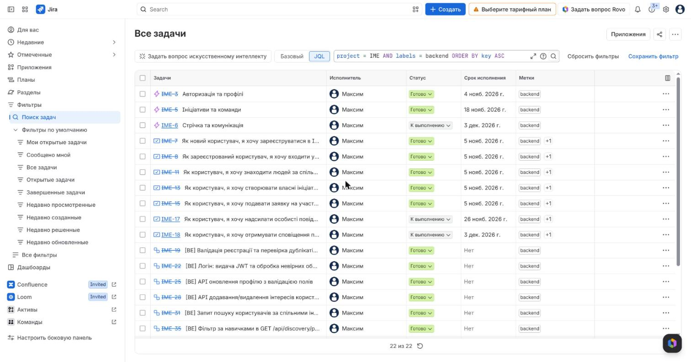
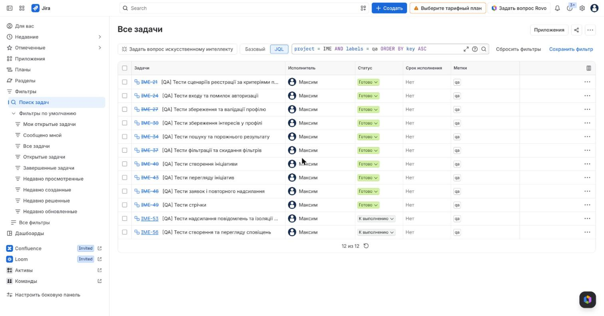
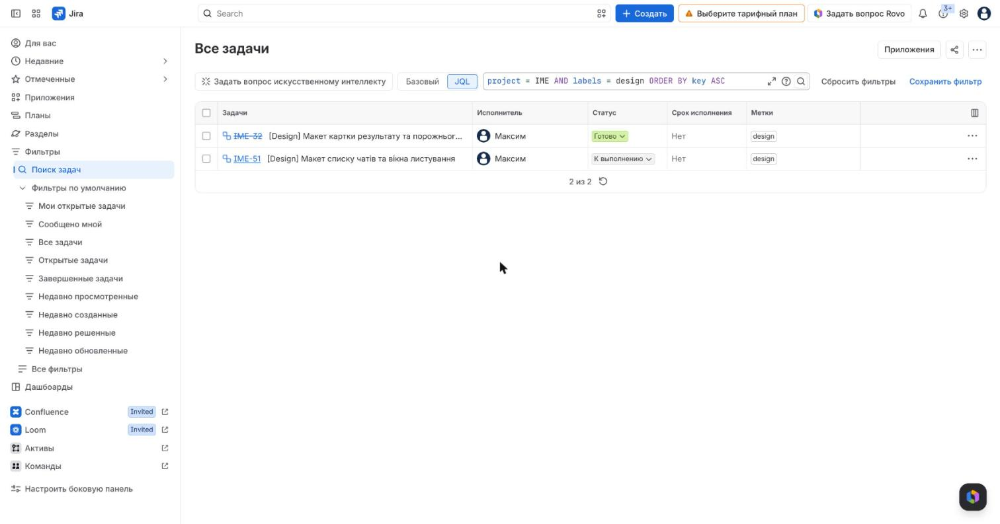

# Лабораторна робота №6
## Управління ресурсами в Jira

**Проєкт:** InteresMe | **Ключ Jira-проєкту:** `IME` ([дошка](https://nubip-team-u9qon6a8.atlassian.net/jira/software/c/projects/IME/boards/2)) | **Дата отримання даних:** 25.11.2026

**Мета роботи:** визначити зони відповідальності та Area Leads, класифікувати задачі Jira за Labels, оцінити доступність і компетенції, розрахувати Capacity та Workload і скласти ресурсний план на наступні спринти.

> **Особливість проєкту.** InteresMe виконується одноосібно (див. [`README.md`](../README.md), [`jira-setup.md`](../jira-setup.md)). Єдиний виконавець — Максим. Andrii Hlazunov має роль `Reviewer` (викладач) і виконавцем задач не є. Фіктивних учасників не створювалось, тому аналіз виконано для одного учасника. Доступність і рівні компетенцій — **планові оцінки, що потребують підтвердження автором**.

---

## 2.1. Склад команди

| Учасник | Ролі в проєкті | Доступність (FTE) | Годин на тиждень |
|---|---|---:|---:|
| Максим | PM, Product Owner, Backend, Frontend, QA, UI/UX Designer, Area Lead усіх зон | 0,50 | 20 |
| **Разом** | | **0,50** | **20** |

`FTE = 20 ÷ 40 = 0,50`. 20 год/тиж — верхня межа з ЛР №2 («15–20 годин на тиждень»), узгоджена з Time Tracking Jira (4 год × 5 днів). Це планова, а не виміряна доступність.

Ролі в Jira: Максим — Administrators (PM, власник розділу); Andrii Hlazunov — Reviewer.

---

## 2.2. Capacity на спринт

| Параметр | Основний сценарій (20 год/тиж) | Сесія (15 год/тиж) |
|---|---|---|
| Тривалість спринту | 2 тижні | 2 тижні |
| FTE | 0,50 | 0,375 |
| Σ годин команди на спринт | 40 год | 30 год |
| Коефіцієнт непродуктивного часу | −20% | −20% |
| Ефективна Capacity | **32 год** | **24 год** |
| Velocity (факт, Sprint 3) | 19 SP | 19 SP |
| Годин на 1 SP | **1,684** (32 ÷ 19) | 1,684 (історична, незмінна) |
| Плановий обсяг наступного спринту | **19 SP** | **14 SP** (⌊24 ÷ 1,684⌋ = ⌊14,25⌋) |

Розрахунок: `Nominal = 20 × 2 = 40`; `Effective = 40 × 0,8 = 32`; `Hours/SP = 32 ÷ 19`; `Planned = ⌊32 ÷ (32/19)⌋ = 19`. Проміжні значення рахувались без округлення.

**Припущення.** Підтвердженої Capacity Sprint 3 немає, тому Hours/SP отримано за умови такої самої доступності (20 год/тиж). Через це плановий обсяг основного сценарію збігається з Velocity Sprint 3 за побудовою. Для порівняння, ЛР №5 дала 2,0 год/SP за Original Estimate (106 год ÷ 53 SP).

| Спринт | Commitment | Completed | Примітка |
|---|---:|---:|---|
| Sprint 1 (21.10–04.11) | 16 | 0 | закрито без виконаних Stories |
| Sprint 2 | 0 | 21 | Stories додано після старту |
| Sprint 3 | 19 | 19 | останній завершений спринт |

Середнє значення в Jira — 13,33 SP; історичні дані не змінювались.

---

## 2.3. Skills Matrix

Шкала: 0 — немає, 1 — базовий, 2 — впевнений, 3 — сильний (самостійно + review). Оцінки **попередні**, до підтвердження автором. Джерела: стек і структура репозиторію (84 коміти з 17.05.2026, 9 модулів API, 11 тестових класів backend, 6 spec-файлів Angular, `ci.yml`, Dockerfile для API і web), задачі Sprint 2–3 та ЛР №1–5. Частина комітів має співавтора-AI (`Co-Authored-By: Claude`), тому наявність коду не прийнято за автоматичне підтвердження особистих навичок.

| Навичка | Максим | Потрібний рівень | Ризик | Обґрунтування |
|---|---:|---:|---|---|
| Frontend (Angular, TypeScript, Tailwind) | 2 | ≥2 | середній | Реалізовані сторінки Sprint 2–3, 6 spec-файлів; частина коду з AI |
| Backend (ASP.NET Core, JWT/OAuth) | 2 | ≥2 | середній | 9 модулів API, власний досвід за ЛР №2 |
| Бази даних (PostgreSQL, EF Core) | 2 | ≥2 | середній | Інтеграційні тести на PostgreSQL; папки міграцій у репозиторії немає |
| Тестування | 2 | ≥1 | середній | 80 інтеграційних тестів, CI (за ЛР №5) |
| DevOps / Deploy (Docker, GitHub Actions) | 1 | ≥1 | середній | Dockerfile та CI є, документованого деплою в цьому репозиторії немає |
| Дизайн / Figma | 1 | ≥1 | середній | Є Subtasks `[Design]`, посилань на Figma-макети немає |
| Git / Code Review | 2 | ≥2 | середній | Git впевнено (історія з осмисленими повідомленнями); незалежного review немає |

Ризик за правилом завдання: «середній» — лише одна особа досягає потрібного рівня; високого (жодної особи) немає.

## 2.4. Аналіз Skills Matrix

| Питання | Відповідь |
|---|---|
| Яка навичка покрита лише однією людиною? | Усі сім, команда з одного учасника. |
| Який Bus Factor у критичних зонах? | backend = 1, frontend = 1, qa = 1, design = 1. Загальний Bus Factor проєкту = **1** (метод: кількість людей, здатних самостійно підтримувати зону з доступом і знаннями про реалізацію). |
| Яка навичка слабка? | Дизайн/Figma (1) і DevOps/Deploy (1); незалежний code review відсутній. |
| Що станеться, якщо єдиний виконавець недоступний? | Робота над усіма зонами зупиняється. Високі оцінки навичок цей ризик не знижують. |

Заходи зменшення наслідків (вони не підвищують Bus Factor до 2, а лише зменшують залежність від неформалізованих знань і спрощують передачу проєкту):

| Навичка / ризик | Захід | Спринт | Критерій успіху |
|---|---|---|---|
| Знання про архітектуру | Описати модулі API та `interesme-web` у документації, ведення записів про технічні рішення | Sprint 4 | Є актуальний опис у `docs/` |
| Запуск проєкту | Інструкція запуску (БД, API, web, Docker) у README | Sprint 4 | Запуск з нуля за інструкцією |
| Backend / DB | Збереження seed, міграцій і автотестів у CI | Sprint 4–5 | CI зелений на кожен коміт |
| Втрата даних | Резервне копіювання репозиторію (GitHub) і БД | Sprint 4 | Є відновлювана копія |
| Якість вимог | Деталізація Acceptance Criteria Stories v1.2 | Sprint 5 | ≥3 AC на Story |
| Дизайн | Макет IME-51 до реалізації IME-52 | Sprint 4 | Макет затверджено |
| Code review | Пошук рецензента (потребує погодження) | Sprint 5 | ≥1 PR перевірено іншою особою |

---

## 2.5. Зони відповідальності

Правило: **кожна Story, Task і Subtask має рівно один Label технічної зони**; службові `must-have`/`should-have`/`could-have` збережено. Зону Story обрано за змістом Acceptance Criteria, Subtasks — за префіксом `[BE]/[FE]/[QA]/[Design]`. Epics отримали зону більшості своїх Stories.

| Label | Area Lead | Кількість задач | Що входить |
|---|---|---:|---|
| `backend` | Максим | 22 | 12 Subtasks `[BE]`, Stories IME-7, 8, 11, 13, 15, 17, 18, Epics IME-3, 5, 6 |
| `frontend` | Максим | 18 | 12 Subtasks `[FE]`, Stories IME-9, 10, 12, 14, 16, Epic IME-4 |
| `qa` | Максим | 12 | 12 Subtasks `[QA]` |
| `design` | Максим | 2 | `[Design]` IME-32, IME-51 |
| **Разом** | | **54** | 4 Epics + 12 Stories + 38 Subtasks |

Зона `infra` не створювалась: у беклозі немає окремих задач CI/деплою; вимогу мінімум чотирьох зон виконано.

**JQL-перевірки (25.11.2026, після запуску Sprint 4):**

| JQL | Результат |
|---|---:|
| `project = IME AND labels is EMPTY` | 0 |
| `project = IME AND (labels is EMPTY OR labels not in (backend, frontend, qa, design))` | 0 |
| `labels = backend` / `frontend` / `qa` / `design` | 22 / 18 / 12 / 2 |
| усі 6 пар зон `labels = A AND labels = B` | 0 |
| `project = IME AND assignee is EMPTY` | 0 |

22 + 18 + 12 + 2 = 54 = усі задачі проєкту. Програмна перевірка масивів Labels: у кожної задачі одна технічна зона.

---

## 2.6. Аналіз Workload

Sprint 4 запущено 25.11.2026 о 11:52 (стандартний інтерфейс Jira), завершення — 09.12.2026 11:52. Склад спринту, Assignee, Labels і SP перед запуском перевірено, Sprint 1–3 не змінювались.

| Учасник | Спринт | Задач | SP committed | SP done | % виконання | Висновок |
|---|---|---:|---:|---:|---:|---|
| Максим | Sprint 1 (21.10–04.11) | 4 Stories | 16 | 0 | 0% | перше планування без декомпозиції |
| Максим | Sprint 2 | 5 Stories | 0 (додано після старту) | 21 | N/A | Commitment = 0 у Jira |
| Максим | Sprint 3 (останній завершений) | 5 Stories | 19 | 19 | **100%** | стабільна Velocity |
| Максим | **Sprint 4 (активний)** | 2 Stories + 7 Subtasks | 13 | 0 | — | усі 9 задач у To Do |

Sprint 4 (дані Jira на 25.11.2026): 9 задач, 13 SP (SP лише на Stories IME-17 = 8, IME-18 = 5; Subtasks SP не мають, повторного підсумовування немає); за зонами backend 4, frontend 2, qa 2, design 1; виконавець усіх задач — Максим; Original Estimate 26 год; Time Spent 0.

| Показник Sprint 4 | 20 год/тиж (Eff. 32 год) | 15 год/тиж (Eff. 24 год) |
|---|---:|---:|
| Оцінені години за Hours/SP: 13 × 32/19 | 21,89 год | 21,89 год |
| Utilization за Hours/SP | **68,4%** | 91,2% |
| Original Estimate (Jira) | 26 год | 26 год |
| Utilization за Original Estimate | **81,25%** (резерв 6 год) | **108,3%** (перевантаження) |

Висновок: за основного сценарію спринт виконуваний із резервом 6 год; під час сесії (15 год/тиж) Original Estimate перевищує Capacity на 2 год, тобто ризик перевантаження реальний, навіть для одного виконавця. Найскладніша задача — IME-17 (8 SP, приватність діалогів, backend).

**Time Tracking** (4 год/день, 5 днів/тиж): 31 worklog, 53 хв, усі від автора Максим, 05.11.2026 (Sprint 2: 17 хв, Sprint 3: 36 хв). За ЛР №5 це машинний час AI-агентів, тому порівнювати його з доступністю 20 год/тиж некоректно. Worklogs не створювались.

---

## 2.7. Вирівнювання завантаження

Між учасниками перепризначень не було (виконавець один; викладач-Reviewer виконавцем бути не може). Заходи для індивідуального проєкту:

| Виявлена проблема | Рішення | Результат |
|---|---|---|
| Sprint 4: 81% (20 год/тиж) або 108% (15 год/тиж) від Capacity | Пріоритизація за MoSCoW: IME-17 (8 SP) — першою, IME-18 (5 SP) — кандидат на перенесення до Sprint 5 лише якщо доступність впаде до 15 год/тиж | SP і спринти не змінювались; рішення приймається за фактичним прогресом |
| Одночасність задач | Обмежити WIP: не більше однієї Story і її Subtasks у In Progress | Менше переключень контексту |
| Резерв | Тримати ≈6 год (19%) нерозподіленими | Є запас на дефекти |
| Порожній беклог після Sprint 4 | Створити нові Stories (v1.2) за результатами рев'ю | Sprint 5 заповнюється реальними задачами |
| Bus Factor = 1 | Заходи з п. 2.4 | Знижують наслідки, але не усувають ризик |

Default assignee перевірено: «Владелец раздела» (Максим), `assigneeType = PROJECT_LEAD`; змін не вносилось. `assignee is EMPTY` → 0.

---

## 2.8. Ресурсний план по спринтах

| Спринт | Період | Потрібні зони | Capacity (год) | План SP | Особливості |
|---|---|---|---:|---:|---|
| Sprint 4 — Комунікація (v1.1), **active** | 25.11.2026 11:52 – 09.12.2026 11:52 | backend, frontend, qa, design | 32 (24 при 15 год/тиж) | 13 з 19 (14 при 15 год) | IME-17, IME-18; Original Estimate 26 год; резерв 6 год |
| Sprint 5 — Резерв (v1.2), **future** | 09.12.2026 – 23.12.2026 | визначаться беклогом | 32 (24 при 15 год/тиж) | 0 з 19 (14 при 15 год) | Створено порожнім: вільних задач у беклозі немає, штучні задачі не додавались |

Sprint 5 заповнюється Stories v1.2 після рев'ю; обсяг не перевищуватиме 19 SP (14 SP під час сесії). Дати сесії не підтверджено, тому їх слід перевірити перед стартом Sprint 5. Sprint 5 не запущено і не заповнено.

---

## 2.9. Скріншоти з Jira

| № | Що на скріншоті | Файл |
|:-:|---|---|
| 1 | Список усіх задач IME із Labels | [img/lab9-labels.png](img/lab9-labels.png) |
| 2 | Board (Sprint 4), групування за Assignee | [img/lab9-workload.png](img/lab9-workload.png) |
| 3 | Board (Sprint 4), групування за Labels | [img/lab9-areas.png](img/lab9-areas.png) |
| 4 | Velocity report | [img/lab9-velocity.png](img/lab9-velocity.png) |
| 5 | Details → Default assignee | [img/lab9-default-assignee.png](img/lab9-default-assignee.png) |
| 6 | Sprint burndown (Sprint 4) | [img/lab9-burndown.png](img/lab9-burndown.png) |
| 7 | Access | [img/lab9-access.png](img/lab9-access.png) |
| 8 | JQL Validation `labels is EMPTY` | [img/lab9-labels-validation.png](img/lab9-labels-validation.png) |
| 9 | Backlog зі Sprint 4 і Sprint 5 | [img/lab9-sprint-planning.png](img/lab9-sprint-planning.png) |
| 10–13 | Задачі зон backend / frontend / qa / design (JQL) | [backend](img/lab9-backend.png), [frontend](img/lab9-frontend.png), [qa](img/lab9-qa.png), [design](img/lab9-design.png) |

Інтерфейс Jira акаунта — російськомовний. Burndown Sprint 4 щойно запущеного спринту містить лише рекомендовану лінію, фактичної динаміки ще немає.

Рис. 1. Задачі проєкту з технічними Labels (50 з 54 на екрані).

Рис. 2. Board Sprint 4, групування за виконавцем: усі 9 задач у Максима.

Рис. 3. Board Sprint 4, групування за Labels (backend — 4 задачі).

Рис. 4. Velocity: Sprint 1 — 16/0, Sprint 2 — 0/21, Sprint 3 — 19/19.

Рис. 5. Default assignee = власник розділу.

Рис. 6. Burndown Sprint 4 (13 SP).

Рис. 7. Максим — Administrators, Andrii Hlazunov — Reviewer.

Рис. 8. `project = IME AND labels is EMPTY` — 0 задач.

Рис. 9. Backlog: Sprint 4 (active) і Sprint 5 (future).

Рис. 10. Зона backend — 22 задачі.

Рис. 11. Зона frontend — 18 задач.

Рис. 12. Зона qa — 12 задач.

Рис. 13. Зона design — 2 задачі.

---

## 2.10. Висновки команди

1. **Навантаження.** Максим — єдиний виконавець. Sprint 4 завантажує його на 68,4% за Hours/SP і на 81,25% за Original Estimate від 32 год. При 15 год/тиж завантаження 108,3% — перевантаження. Недовантажених немає.
2. **Bus Factor = 1** у всіх зонах. Документація, інструкція запуску, автотести й резервні копії зменшують наслідки зупинки, але не підвищують Bus Factor.
3. **Реалістичність SP.** 13 SP менше за Velocity 19 SP і вкладається в Capacity 32 год. Прогноз 19 SP збігається з Velocity за побудовою (припущення про однакову доступність).
4. **Найбільша зона** — backend (22 задачі, 41%), далі frontend (18), qa (12), design (2).
5. **Відповідність компетенціям.** Ключові навички (frontend, backend, БД) мають рівень 2; слабкі — дизайн і деплой (рівень 1). Оцінки попередні.
6. **Зміни в Jira.** Додано по одному Label зони всім 54 задачам; запущено Sprint 4 (25.11.2026 11:52); створено Sprint 5 (09–23.12.2026, future). Assignee, статуси, SP, worklogs і Sprint 1–3 не змінювались.
7. **Рішення на наступні спринти:** вести Sprint 4 з WIP-обмеженням; перевірити доступність у сесію; підготувати Stories v1.2 з ≥3 Acceptance Criteria; виконати заходи з п. 2.4.

---

## Методологічні обмеження

- Доступність (20 та 15 год/тиж) і рівні компетенцій — оцінки автора за документацією, а не результат опитування; **потребують підтвердження автором**.
- Історична Capacity Sprint 1–3 невідома; Hours/SP розраховано за припущенням про 20 год/тиж.
- Worklogs у Jira — машинний час AI-агентів, у розрахунках Capacity не використовувались.
- Дати Sprint 5 — планові (після завершення Sprint 4).
