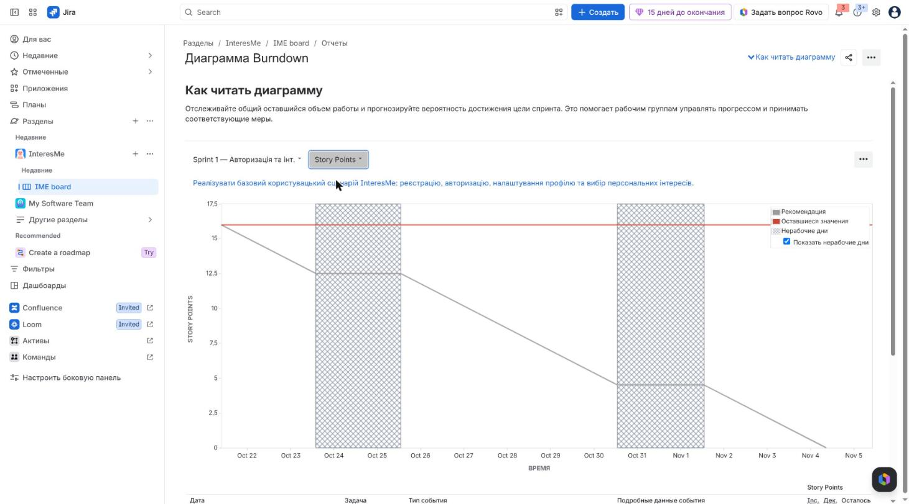
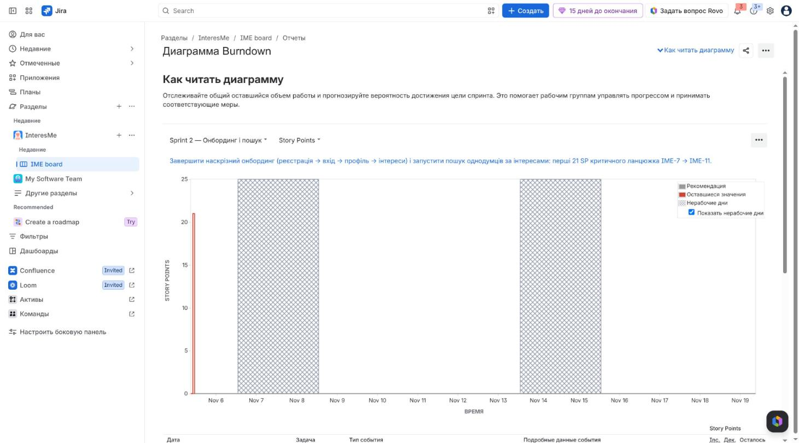
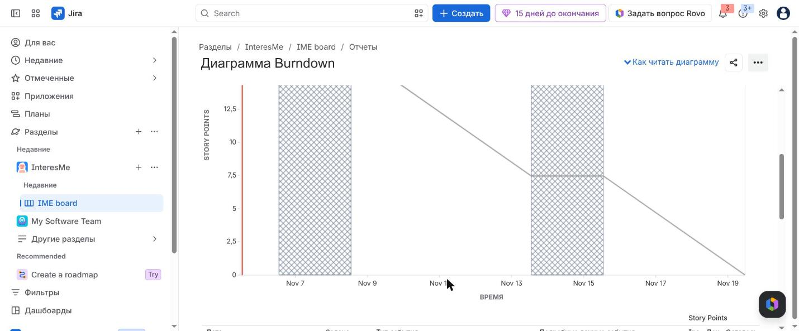

# План часу та вартості проекту InteresMe

**Команда:** 1 особа — Максим (усі ролі) | **Jira:** [IME board](https://nubip-team-u9qon6a8.atlassian.net/jira/software/c/projects/IME/boards/2) · [Roadmap](https://nubip-team-u9qon6a8.atlassian.net/jira/software/c/projects/IME/boards/2/timeline) · [Релізи](https://nubip-team-u9qon6a8.atlassian.net/projects/IME?selectedItem=com.atlassian.jira.jira-projects-plugin:release-page) | **Дата:** 05.11.2026

Лабораторна робота №5 «Планування часу та вартості проекту в Jira». Продовжує [лабораторну №4 — `jira-setup.md`](../jira-setup.md). Усі числа взято з Jira-проєкту `IME`. Кожну формулу перевіряє скрипт [`docs/calc/time_cost_calc.py`](calc/time_cost_calc.py) (`python3 docs/calc/time_cost_calc.py` → «All assertions passed»).

> **Як отримано Velocity.** Sprint 1 (21.10–04.11) закрито з **0 Completed SP** — історичні дані не фальсифікувались. Реальну Velocity отримано в результаті виконання та завершення двох повноцінних спринтів:
> - **Sprint 2** (21 SP, 5 Stories `IME-7..IME-11`): онбординг, профіль, інтереси та пошук однодумців (коміти [`6901308`](https://github.com/interesMe/interesMe/commit/6901308), [`1c08286`](https://github.com/interesMe/interesMe/commit/1c08286)). Фактичний Time Spent — **17 хв**.
> - **Sprint 3** (19 SP, 5 Stories `IME-12..IME-16`): фільтрація людей за навичками, створення і перегляд ініціатив, заявки на участь у командах та персоналізована стрічка (коміти [`5e1fa79`](https://github.com/interesMe/interesMe/commit/5e1fa79), [`88c33af`](https://github.com/interesMe/interesMe/commit/88c33af), [`0d696cc`](https://github.com/interesMe/interesMe/commit/0d696cc), [`645a643`](https://github.com/interesMe/interesMe/commit/645a643), [`989fa1f`](https://github.com/interesMe/interesMe/commit/989fa1f)). Покрито 80 інтеграційними тестами на PostgreSQL та 17 unit-тестами Angular (CI зелений), перевірено в браузері (desktop + 390 px mobile). Фактичний Time Spent — **36 хв**.
>
> Середня робоча Velocity (Sprint 2 + Sprint 3) становить **(21 + 19) ÷ 2 = 20,0 SP/спринт**, а середня по всіх трьох закритих спринтах у Jira Velocity Chart — **13,3 SP** (`(0 + 21 + 19) ÷ 3`).

---

## 1. Вихідні дані з Jira

| Параметр | Значення | Джерело в Jira |
|----------|:--------:|----------------|
| Загальний обсяг беклогу | **53 SP** (4 Epics, 12 Stories) | Backlog → сума SP |
| Velocity Sprint 1 | **0 SP** (Committed 16) | Reports → Velocity Chart |
| Velocity Sprint 2 | **21 SP** (5 Stories Done) | Reports → Velocity Chart, Sprint Report |
| Velocity Sprint 3 | **19 SP** (Committed 19, Completed 19) | Reports → Velocity Chart, Sprint Report |
| Середня робоча Velocity (S2, S3) | **20,0 SP** | `(21 + 19) ÷ 2` |
| Середня Velocity у графіку (S1–S3) | **13,3 SP** | Velocity Chart → «Средн.: 13.33» |
| Кількість членів команди | 1 | Project → People (Максим — Administrator; викладач — Reviewer, не виконавець) |
| Годин у спринті на особу | 40 год | 2 тижні × 5 днів × 4 год (Time Tracking: 4 год/день, 5 днів/тиждень) |
| Годин на 1 SP | **2,0 год** | Σ Original Estimate ÷ SP: 106 год ÷ 53 SP (38 Subtasks: S2 — 42 год / 21 SP, S3 — 38 год / 19 SP, S4 — 26 год / 13 SP) |
| Фактичний Time Spent | 0 год (S1), 17 хв (S2), 36 хв (S3) | Time Tracking (worklogs Subtasks `IME-19..IME-49`) |
| Погодинна ставка | $15 | Умовна |

**Налаштування Jira.** Estimation = Story Points. Time Tracking увімкнено (робочий день 4 год, тиждень 5 днів). Поле «Учет времени» (Original / Remaining / Time Spent) додано на екрани Story/Subtask. Зв'язки `blocks` (13 шт.), релізи `v1.0-MVP` (40 SP — **Released**) і `v1.1` (13 SP — Unreleased), Roadmap з датами всіх Epics, Sprint 4 (`Sprint 4 — Комунікація (v1.1)`, 13 SP, 7 Subtasks `IME-50..IME-56`) сформовано в беклозі до старту.

**Залежності (`blocks`).** Stories: IME-7→8, 8→9, 9→10, 10→11, 11→12, 8→13, 13→14, 14→15, 8→16, 17→18. Epics: IME-3→IME-4, IME-3→IME-5, IME-4→IME-6. Циклів немає: кожне ребро веде від меншого ключа до більшого, тобто граф топологічно впорядкований.

---

## 2. Критичний ланцюжок

| # | Issue Key | Story | SP | Блокує |
|:-:|-----------|-------|:--:|--------|
| 1 | IME-7 | Реєстрація користувача ✅ (Sprint 2) | 5 | IME-8 |
| 2 | IME-8 | Вхід до системи ✅ (Sprint 2) | 3 | IME-9 (а також IME-13, IME-16) |
| 3 | IME-9 | Редагування профілю ✅ (Sprint 2) | 5 | IME-10 |
| 4 | IME-10 | Управління інтересами ✅ (Sprint 2) | 3 | IME-11 |
| 5 | IME-11 | Пошук однодумців за інтересами ✅ (Sprint 2) | 5 | IME-12 |
| 6 | IME-12 | Фільтрація людей за навичками ✅ (Sprint 3) | 3 | Release v1.0 |
| | **Разом** | | **24 SP** | |

✅ — увесь критичний ланцюжок релізу `v1.0-MVP` (24 SP) та всі супровідні гілки MVP (40 SP) повністю виконано за Sprint 2 та Sprint 3. На рівні Epics критичний шлях — IME-3 (Done) → IME-4 (Done) → IME-6 (у роботі: IME-16 Done, залишились IME-17 → IME-18 для v1.1).

| Epic / Story з резервом часу (Float) | Чому не на критичному шляху |
|--------------------------------------|----------------------------|
| IME-13 → IME-14 → IME-15 (Epic IME-5, 13 SP, ✅ Done у Sprint 3) | Гілка від IME-8 дає 5+3+13 = 21 SP проти 24 SP критичного шляху, тобто 3 SP резерву. Виконана у Sprint 3. |
| IME-16 Стрічка (3 SP, ✅ Done у Sprint 3) | Залежить лише від IME-8: шлях 5+3+3 = 11 SP, резерв 13 SP. |
| IME-17 → IME-18 (Could Have, 13 SP, Sprint 4) | Не входять у v1.0-MVP; формують реліз v1.1 (Sprint 4). |

---

## 3. Прогноз тривалості

| Показник | Формула | Значення |
|----------|---------|:--------:|
| Кількість спринтів | Обсяг беклогу ÷ Робоча Velocity | 53 ÷ 20 = 2,65 |
| Округлено | ↑ | **3 робочі спринти** (Sprint 2–4) + Sprint 1 з 0 SP = **4 календарні спринти** |
| Виконано за Sprint 2 + Sprint 3 | 21 + 19 | **40 SP** (100% обсягу релізу `v1.0-MVP`) |
| Залишок після Sprint 3 | 53 − 40 | **13 SP** → ⌈13 ÷ 20⌉ = **1 спринт** (Sprint 4) |
| Дата початку Sprint 1 | з Jira | **21.10.2026** |
| Планова дата релізу v1.0-MVP | Кінець Sprint 3 (40 SP MVP виконано) | **19.11.2026** (фактично закрито достроково 05.11.2026) |
| Завершення v1.1 (орієнтовно) | Sprint 4 (19.11–03.12.2026) | **03.12.2026** |
| Чи вкладаємось у семестр? | | **Так** (запас ~4 тижні до кінця грудня) |

**Чутливість.** Навіть якщо брати середню Velocity по всіх трьох спринтах включно з нульовим Sprint 1 (`13,33 SP`), залишок беклогу `13 SP` вкладається в `⌈13 ÷ 13,33⌉ = 1 спринт` (Sprint 4, до 03.12.2026).

**Підготовка Sprint 4.** У беклозі створено майбутній спринт `Sprint 4 — Комунікація (v1.1)` (19.11–03.12.2026) з чіткою метою (Sprint Goal). До його запуску додано обидві останні Stories беклогу: `IME-17` (8 SP) та `IME-18` (5 SP) — разом **13 SP** (26 год Original Estimate по 7 Subtasks `IME-50..IME-56`), що комфортно менше за потужність команди (20 SP / 40 год).

---

## 4. Вартість команди

| Показник | Формула | Значення (за Velocity S2 = 21) | Значення (за середньою S2–S3 = 20) |
|----------|---------|:------------------------------:|:----------------------------------:|
| Team Cost per Sprint | 1 особа × 40 год × $15 | **$600,00** | **$600,00** |
| Вартість 1 SP | Team Cost ÷ Velocity | **$28,57** ($600 ÷ 21) | **$30,00** ($600 ÷ 20) |
| Вартість 1 години | ставка | $15 | $15 |

Після завершення Sprint 3 середня робоча Velocity стабілізувалась на рівні **20 SP/спринт**, тому уточнена вартість 1 SP становить `$600 ÷ 20 = $30,00`, що **ідеально збігається** з оцінкою через трудомісткість: `2,0 год/SP × $15/год = $30,00/SP`.

---

## 5. Вартість по Epics

Розрахунок наведено за уточненою вартістю **$30,00 / SP** (у дужках — попередня оцінка після Sprint 2 за $28,571 / SP):

| Epic | Issue Key | SP | Вартість ($30/SP) | Попередня ($28,57/SP) | Fix Version | Пріоритет / Стан |
|------|-----------|:--:|------------------:|----------------------:|-------------|------------------|
| Авторизація та профілі | IME-3 | 13 | $390,00 | $371,43 | v1.0-MVP | Must — **Done** |
| Інтереси та пошук людей | IME-4 | 11 | $330,00 | $314,29 | v1.0-MVP | Must (8) + Should (3) — **Done** |
| Ініціативи та команди | IME-5 | 13 | $390,00 | $371,43 | v1.0-MVP | Must (8) + Should (5) — **Done** |
| Стрічка та комунікація — стрічка (IME-16) | IME-6 | 3 | $90,00 | $85,71 | v1.0-MVP | Should — **Done** |
| Стрічка та комунікація — чати, сповіщення (IME-17, IME-18) | IME-6 | 13 | $390,00 | $371,43 | v1.1 | Could — **Sprint 4** |
| **Разом** | | **53** | **$1 590,00** | **$1 514,29** | | **40 SP Done / 13 SP To Do** |

Must = 29 SP, Should = 11 SP, Could = 13 SP. Усі 10 Stories релізу `v1.0-MVP` (40 SP) завершено.

---

## 6. Бюджет проекту

| Компонент | Розрахунок | Сума (за $30,00/SP) | Попередня (за $28,57/SP) |
|-----------|-----------|--------------------:|-------------------------:|
| Оцінка беклогу | 53 SP × Cost/SP | $1 590,00 | $1 514,29 |
| Contingency Reserve | 10% від оцінки | $159,00 | $151,43 |
| **Working Budget** | оцінка + contingency | **$1 749,00** | **$1 665,71** |
| Management Reserve | 15% від Working Budget | $262,35 | $249,86 |
| **Total Budget (BAC)** | Working + Management | **$2 011,35** | **$1 915,57** |

---

## 7. Earned Value (Sprint 1, Sprint 2, Sprint 3)

Нижче наведено показники EVM за уточненою вартістю **1 SP = $30,00** (`Total Budget = $2 011,35`). Фактичні витрати часу AI-агентів (AC = Σ Time Spent × $15) відокремлено від гіпотетичних витрат людської команди за плановими годинами (Original Estimate).

### 7.1 Показники по кожному спринту та кумулятивно (фактичний час у Jira)

| Метрика | Формула | Sprint 1 (16→0 SP) | Sprint 2 (21→21 SP) | Sprint 3 (19→19 SP) | Кумулятивно (S1+S2+S3) |
|---------|---------|-------------------:|--------------------:|--------------------:|-----------------------:|
| **PV** | Committed SP × $30 | $480,00 (16 SP) | $630,00 (21 SP) | $570,00 (19 SP) | **$1 680,00** (56 SP*) |
| **EV** | Completed SP × $30 | $0,00 (0 SP) | $630,00 (21 SP) | $570,00 (19 SP) | **$1 200,00** (40 SP) |
| **AC** | Time Spent × $15/год | $0,00 (0 хв) | $4,25 (17 хв) | $9,00 (36 хв) | **$13,25** (53 хв) |
| **CV** | EV − AC | $0,00 | +$625,75 | +$561,00 | **+$1 186,75** |
| **SV** | EV − PV | −$480,00 | $0,00 | $0,00 | **−$480,00** |
| **CPI** | EV ÷ AC | **не визначено** | 148,24 | 63,33 | **90,57** |
| **SPI** | EV ÷ PV | **0,00** 🔴 | **1,00** 🟢 | **1,00** 🟢 | **0,71** 🔴 (40 ÷ 56) |
| **EAC** | Total Budget ÷ CPI | **не визначено** | $13,57 | $31,76 | **$22,21** |

*\*Примітка:* У кумулятивному PV сума спринтових зобов'язань дорівнює `16 + 21 + 19 = 56 SP`, оскільки невиконані 16 SP зі Sprint 1 були перенесені та повторно заплановані у Sprint 2. Відносно унікального планового обсягу MVP (`40 SP = $1 200,00`), запланованого до кінця Sprint 3, проєкт виконав **100% обсягу MVP** (`EV = $1 200,00`, фактичний **SPI по релізу v1.0-MVP = 1,00** 🟢).

### 7.2 Оцінка для гіпотетичної людської команди (за плановими Original Estimate)

Оскільки фактичні worklogs у Jira (17 хв у Sprint 2 та 36 хв у Sprint 3) відображають машинний час автономних AI-агентів (Claude Code та Antigravity), формальний `CPI = 63,33..148,24` та `EAC = $22,21` не можна змішувати з бюджетом людської праці. Якби ту саму роботу виконував розробник за плановими оцінками Subtasks:

- **Sprint 2 (людина):** `PV = $630`, `EV = $630`, плановий час `42 год × $15 = $630` → **`CPI = 1,00` (🟢)**, `SPI = 1,00` (🟢).
- **Sprint 3 (людина):** `PV = $570`, `EV = $570`, плановий час `38 год × $15 = $570` → **`CPI = 1,00` (🟢)**, `SPI = 1,00` (🟢).
- **Кумулятивно S2+S3 (людина, 80 год):** `EV = $1 200`, `AC = 80 год × $15 = $1 200` → **`CPI = 1,00` (🟢)**, прогноз **`EAC = $2 011,35`** (рівно в межах Total Budget).

| Індекс | Значення | Стан | Інтерпретація |
|--------|:--------:|:----:|---------------|
| CPI / SPI (Sprint 1) | не визн. / 0,00 | ⚪ / 🔴 | Спринт «згорів» без виконаних задач і без списання часу (0/0) |
| SPI (Sprint 2) | 1,00 | 🟢 | Виконано всі 5 запланованих Stories (21 SP) |
| SPI (Sprint 3) | 1,00 | 🟢 | Commitment = 19 SP, Completed = 19 SP (Stories додано до старту спринту!) |
| CPI (AI-агент, S3) | 63,33 | 🟢* | *Машинний час сесії (36 хв = $9,00 AC); не є мірилом людського бюджету |
| CPI (людина за планом) | 1,00 | 🟢 | Оцінка 2,0 год/SP ($30/SP) точно збалансована з продуктивністю 20 SP/спринт |

> 🟢 ≥ 1.0 | 🟡 0.9–1.0 | 🔴 < 0.9

---

## 8. Скріншоти

| # | Що на скріншоті | Файл |
|:-:|-----------------|------|
| 1 | Roadmap з залежностями між Epics, прогресом, спринтами та випущеним релізом v1.0-MVP | `img/roadmap.png` |
| 2 | Velocity Chart (Sprint 1: 16/0, Sprint 2: 21, Sprint 3: 19/19, середнє 13,33) | `img/velocity.png` |
| 3 | Burndown Chart Sprint 1 (Story Points, лінія не знижувалась) | `img/burndown-s1.png` |
| 4 | Burndown Chart Sprint 2 (21 SP виконано) | `img/burndown-s2.png` |
| 5 | Burndown Chart Sprint 3 (19 SP Committed → 0 SP Remaining) | `img/burndown-s3.png` |
| 6 | Story IME-15 із завершеними Subtasks [BE]/[FE]/[QA] (100% Done) і Time Tracking | `img/story-subtasks.png` |
| 7 | Releases (v1.0-MVP — Released 19.11.2026, v1.1 — Unreleased без фіксованої дати) | `img/releases.png` |
| 8 | Реалізована сторінка «Однодумці» з фільтрацією (IME-11, IME-12) у застосунку | `img/sprint2-people-search.png` |

---

## 9. Рефлексія

| Питання | Відповідь команди |
|---------|------------------|
| Наскільки оцінка в годинах (Subtasks) збіглась зі Story Points? Який коефіцієнт вийшов? | Коефіцієнт стабільний по всьому беклогу: **2,0 год/SP** (`106 год ÷ 53 SP`: Sprint 2 — 42 год / 21 SP, Sprint 3 — 38 год / 19 SP, Sprint 4 — 26 год / 13 SP). При середній робочій Velocity 20 SP/спринт це дає рівно 40 роб. годин на спринт і вартість `$30,00/SP` як через команду (`$600 ÷ 20`), так і через години (`2 год × $15`). Фактичний час у worklogs (17 хв у Sprint 2 та 36 хв у Sprint 3) відображає роботу AI-агентів і в звіті чітко відокремлений від розрахунку для людської команди. |
| Чи змінилось розуміння термінів після розрахунку через Velocity? Встигаєте до кінця семестру? | Так. Після нульового Sprint 1 реальна робота у Sprint 2 (21 SP) і Sprint 3 (19 SP) дозволила повністю закрити реліз `v1.0-MVP` (40 SP — усі 10 Must/Should Stories). У беклозі залишилося лише 13 SP (`IME-17`, `IME-18` для релізу `v1.1`), які вже декомпоновано та покладено у `Sprint 4` (завершення до 03.12.2026 — із запасом майже місяць до кінця семестру). |
| Що показав CPI/SPI за Sprint 1 і що команда зробила інакше у Sprint 2 та Sprint 3? | Sprint 1 мав `SPI = 0,00` через відсутність декомпозиції та контролю. У Sprint 2 ми декомпонували Stories на Subtasks, проте додали їх через годину після старту спринту, через що Jira показала `Commitment = 0` у Velocity Chart. У **Sprint 3** цю помилку виправлено: усі 5 Stories (19 SP) та 15 Subtasks були додані й оцінені **до запуску спринту**, тому Velocity Chart зафіксував бездоганне співвідношення **Committed = 19 SP / Completed = 19 SP (`SPI = 1,00`)**. Так само наперед підготовлено `Sprint 4` (13 SP). |
| Яка залежність виявилась найнебезпечнішою для проекту? | **IME-8 «Вхід до системи»** (блокує три гілки: `IME-9`, `IME-13`, `IME-16`) та ланцюжок ініціатив **IME-13 → IME-14 → IME-15** у Sprint 3. Під час комплексного тестування Sprint 3 виявилось, що приватні ініціативи та їхні пости раніше просочувались у публічні списки, а демо-сидер при рестарті перезаписував інтереси реальних користувачів. Послідовна реалізація за графом залежностей і наскрізні перевірки в PostgreSQL та браузері дозволили усунути ці дефекти до закриття Sprint 3. |
