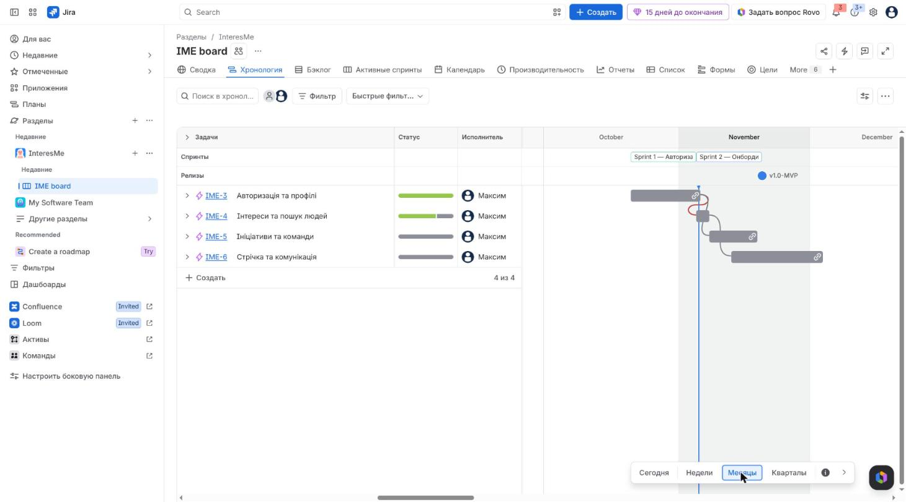
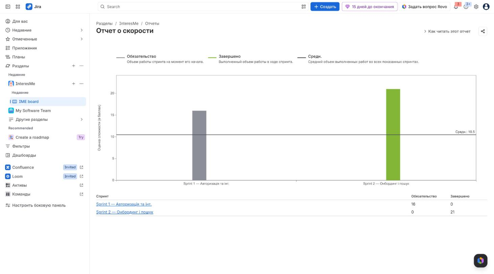
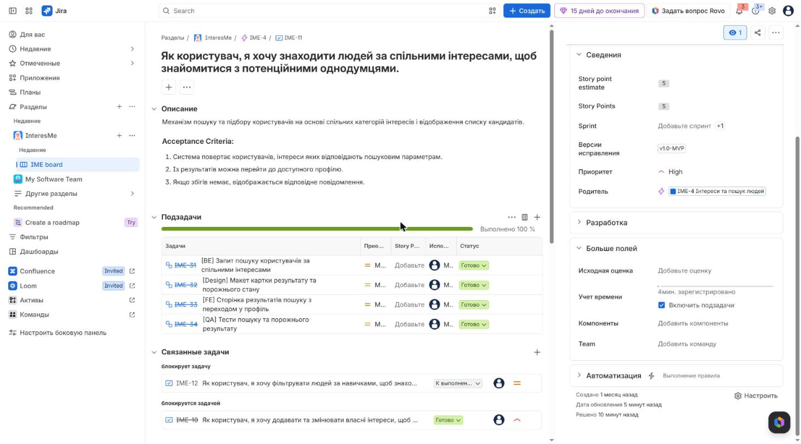
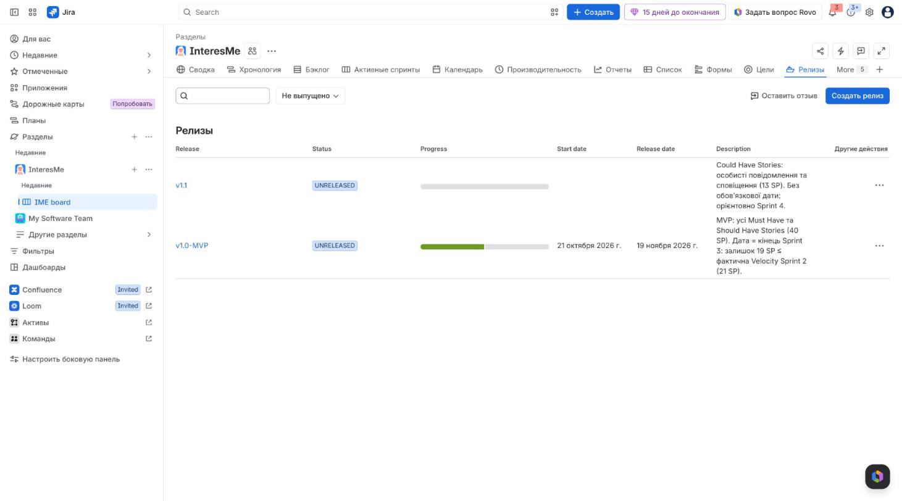
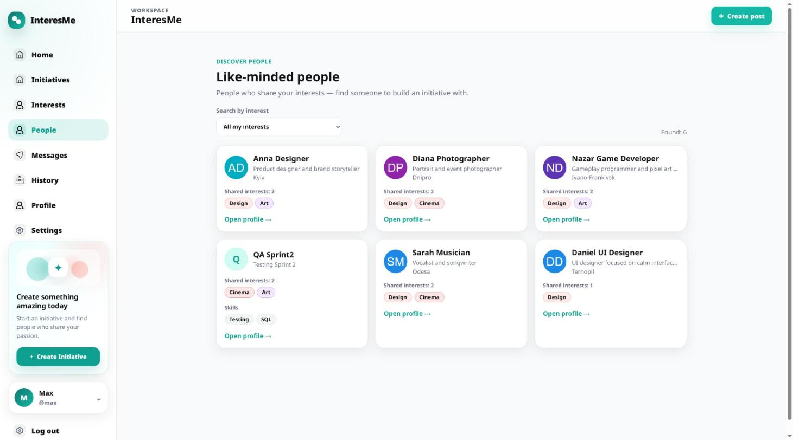

# План часу та вартості проекту InteresMe

**Команда:** 1 особа — Максим (усі ролі) | **Jira:** [IME board](https://nubip-team-u9qon6a8.atlassian.net/jira/software/c/projects/IME/boards/2) · [Roadmap](https://nubip-team-u9qon6a8.atlassian.net/jira/software/c/projects/IME/boards/2/timeline) · [Релізи](https://nubip-team-u9qon6a8.atlassian.net/projects/IME?selectedItem=com.atlassian.jira.jira-projects-plugin:release-page) | **Дата:** 05.11.2026

Лабораторна робота №5 «Планування часу та вартості проекту в Jira». Продовжує [лабораторну №4 — `jira-setup.md`](../jira-setup.md). Усі числа взято з Jira-проєкту `IME`. Кожну формулу перевіряє скрипт [`docs/calc/time_cost_calc.py`](calc/time_cost_calc.py) (`python3 docs/calc/time_cost_calc.py` → «All assertions passed»).

> **Як отримано Velocity.** Sprint 1 (21.10–04.11) закрито з **0 Completed SP**. Задачі не переводилися у Done штучно: у Jira не було ні змін статусу, ні worklog. Ця історична Velocity лишається без змін. Реальну Velocity отримано у **Sprint 2**: усі 5 Stories (21 SP) реалізовано в коді (коміт [`6901308`](https://github.com/interesMe/interesMe/commit/6901308)), покрито тестами (43 backend-тести на PostgreSQL + Angular specs; CI зелений, коміт [`1c08286`](https://github.com/interesMe/interesMe/commit/1c08286)), перевірено в браузері, і лише потім закрито в Jira. Роботу виконав AI-агент Claude Code в акаунті Максима, тому фактичний Time Spent — **17 хв**. Як це впливає на AC/CPI, пояснено в розділі 7.

---

## 1. Вихідні дані з Jira

| Параметр | Значення | Джерело в Jira |
|----------|:--------:|----------------|
| Загальний обсяг беклогу | **53 SP** (4 Epics, 12 Stories) | Backlog → сума SP |
| Velocity Sprint 1 | **0 SP** (Committed 16) | Reports → Velocity Chart |
| Velocity Sprint 2 | **21 SP** (5 Stories Done) | Reports → Velocity Chart, Sprint Report |
| Середня Velocity (S1, S2) | 10,5 SP | Velocity Chart → «Средн.: 10.5» |
| Кількість членів команди | 1 | Project → People (Максим — Administrator; викладач — Reviewer, не виконавець) |
| Годин у спринті на особу | 40 год | 2 тижні × 5 днів × 4 год (Time Tracking: 4 год/день, 5 днів/тиждень) |
| Годин на 1 SP | **2,0 год** | Σ Original Estimate ÷ SP: 80 год ÷ 40 SP (31 Subtask, Sprint 2: 42 год / 21 SP, Sprint 3: 38 год / 19 SP) |
| Фактичний Time Spent | 0 год (Sprint 1), 17 хв (Sprint 2) | Time Tracking (worklogs Subtasks) |
| Погодинна ставка | $15 | Умовна |

**Налаштування Jira.** Estimation = Story Points. Time Tracking увімкнено (робочий день 4 год, тиждень 5 днів). Поле «Учет времени» (Original / Remaining / Time Spent) додано на екрани Story/Subtask. Зв'язки `blocks` (13 шт.), релізи `v1.0-MVP` і `v1.1`, Roadmap з датами всіх Epics, Sprint 3 запущено. Зовнішніх залежностей (API університету, доступи) немає, тому окрему Task з міткою `external-dependency` не створено.

**Залежності (`blocks`).** Stories: IME-7→8, 8→9, 9→10, 10→11, 11→12, 8→13, 13→14, 14→15, 8→16, 17→18. Epics: IME-3→IME-4, IME-3→IME-5, IME-4→IME-6. Циклів немає: кожне ребро веде від меншого ключа до більшого, тобто граф топологічно впорядкований.

---

## 2. Критичний ланцюжок

| # | Issue Key | Story | SP | Блокує |
|:-:|-----------|-------|:--:|--------|
| 1 | IME-7 | Реєстрація користувача ✅ | 5 | IME-8 |
| 2 | IME-8 | Вхід до системи ✅ | 3 | IME-9 (а також IME-13, IME-16) |
| 3 | IME-9 | Редагування профілю ✅ | 5 | IME-10 |
| 4 | IME-10 | Управління інтересами ✅ | 3 | IME-11 |
| 5 | IME-11 | Пошук однодумців за інтересами ✅ | 5 | IME-12 |
| 6 | IME-12 | Фільтрація людей за навичками (Sprint 3) | 3 | Release v1.0 |
| | **Разом** | | **24 SP** | |

✅ — виконано у Sprint 2. Із 24 SP критичного ланцюжка залишилось 3 SP (IME-12, перша Story Sprint 3). На рівні Epics критичний шлях — IME-3 → IME-4 → IME-6.

| Epic / Story з резервом часу (Float) | Чому не на критичному шляху |
|--------------------------------------|----------------------------|
| IME-13 → IME-14 → IME-15 (Epic IME-5, 13 SP) | Гілка від IME-8 дає 5+3+13 = 21 SP проти 24 SP критичного шляху, тобто 3 SP резерву. Може йти паралельно з IME-9…IME-12. |
| IME-16 Стрічка (3 SP) | Залежить лише від IME-8: шлях 5+3+3 = 11 SP, резерв 13 SP. |
| IME-17 → IME-18 (Could Have, 13 SP) | Не входять у v1.0-MVP; реліз v1.1 без обов'язкової дати. |

---

## 3. Прогноз тривалості

| Показник | Формула | Значення |
|----------|---------|:--------:|
| Кількість спринтів | Обсяг беклогу ÷ Velocity | 53 ÷ 21 = 2,52 |
| Округлено | ↑ | **3 спринти роботи** (Sprint 2–4) + Sprint 1 з 0 SP = **4 календарні спринти** |
| Залишок після Sprint 2 | 53 − 0 − 21 | 32 SP → ⌈32 ÷ 21⌉ = **2 спринти** (Sprint 3, Sprint 4) |
| Дата початку Sprint 1 | з Jira | **21.10.2026** |
| Дата релізу v1.0-MVP | Sprint 3: залишок MVP 19 SP ≤ 21 | **19.11.2026** |
| Завершення v1.1 (орієнтовно) | Sprint 4 | 03.12.2026 |
| Чи вкладаємось у семестр? | | **Так** (запас ~3 тижні до кінця грудня) |

**Чутливість.** Якщо брати середню Velocity 10,5 SP (з урахуванням Sprint 1), то MVP займе ⌈19 ÷ 10,5⌉ = 2 спринти (03.12.2026), а весь беклог ⌈32 ÷ 10,5⌉ = 4 спринти (31.12.2026). У семестр це ледь вкладається. Velocity 21 отримано за участі AI-агента, тож для людської команди реалістичніша нижня межа.

**Sprint 3 спланований за фактичною Velocity.** `Sprint 3 — Ініціативи та MVP` (05.11–19.11, ACTIVE): IME-12, IME-13, IME-14, IME-15, IME-16 = **19 SP** (19 ÷ 21 = −9,5 %, у межах ±10 %). Першою йде IME-12 з критичного ланцюжка. Кожна Story має 3 Subtasks з Original Estimate (38 год) та Assignee.

---

## 4. Вартість команди

| Показник | Формула | Значення |
|----------|---------|---------:|
| Team Cost per Sprint | 1 особа × 40 год × $15 | **$600,00** |
| Вартість 1 SP | Team Cost ÷ Velocity = $600 ÷ 21 | **$28,57** |
| Вартість 1 години | ставка | $15 |

За Velocity Sprint 1 вартість SP не визначена: $600 ÷ 0 — ділення на нуль. Тому використано першу достовірну ненульову Velocity (Sprint 2). Перевірка через години: 2,0 год/SP × $15 = $30/SP, що близько до $28,57.

---

## 5. Вартість по Epics

| Epic | Issue Key | SP | Вартість | Fix Version | Пріоритет |
|------|-----------|:--:|---------:|-------------|-----------|
| Авторизація та профілі | IME-3 | 13 | $371,43 | v1.0-MVP | Must |
| Інтереси та пошук людей | IME-4 | 11 | $314,29 | v1.0-MVP | Must (8 SP) + Should (3 SP) |
| Ініціативи та команди | IME-5 | 13 | $371,43 | v1.0-MVP | Must (8 SP) + Should (5 SP) |
| Стрічка та комунікація — стрічка (IME-16) | IME-6 | 3 | $85,71 | v1.0-MVP | Should |
| Стрічка та комунікація — повідомлення, сповіщення (IME-17, IME-18) | IME-6 | 13 | $371,43 | v1.1 | Could |
| **Разом** | | **53** | **$1 514,29** | | |

Розрахунок: SP × $28,571 (= $600 ÷ 21). Must = 29 SP, Should = 11 SP, Could = 13 SP. Fix Version `v1.0-MVP` мають усі 10 Must/Should Stories, `v1.1` — 2 Could Stories.

---

## 6. Бюджет проекту

| Компонент | Розрахунок | Сума |
|-----------|-----------|-----:|
| Оцінка беклогу | 53 SP × $28,571 | $1 514,29 |
| Contingency Reserve | 10% від оцінки | $151,43 |
| **Working Budget** | оцінка + contingency | **$1 665,71** |
| Management Reserve | 15% від Working Budget | $249,86 |
| **Total Budget** | Working + Management | **$1 915,57** |

---

## 7. Earned Value за Sprint 1

Вартість SP для всіх EVM-розрахунків — $28,571 (розділ 4). AC = Σ Time Spent × $15.

### 7.1 Sprint 1 — історичні дані (без змін)

| Метрика | Розрахунок | Значення | Джерело в Jira |
|---------|-----------|---------:|----------------|
| PV | 16 SP × $28,571 | $457,14 | Sprint Report → Committed 16 |
| EV | 0 SP × $28,571 | $0,00 | Sprint Report → Completed 0 |
| AC | 0 год × $15 | $0,00 | Time Tracking: worklogs відсутні |
| **CV** | EV − AC = 0 − 0 | $0,00 | |
| **SV** | EV − PV = 0 − 457,14 | −$457,14 | |
| **CPI** | EV ÷ AC = 0 ÷ 0 | **не визначено** | |
| **SPI** | EV ÷ PV = 0 ÷ 457,14 | **0,00** | |
| **EAC** | Total Budget ÷ CPI | **не визначено** | |

Time Spent за Sprint 1 не заповнювався. За умовою AC тоді рахується як «члени команди × фактично відпрацьовані години × $15». Свідчень роботи над Stories Sprint 1 немає: жодного переходу статусу, worklog чи коміту з кодом за 21.10–04.11. Тому фактично відпрацьовані години = 0 і AC = 1 × 0 × $15 = $0. CPI = 0/0 та EAC = $1 915,57/CPI математично не визначені, підставних значень не використано.

### 7.2 Sprint 2 — реальні дані виконаної роботи (додатковий аналіз)

| Метрика | Розрахунок | Значення | Джерело в Jira |
|---------|-----------|---------:|----------------|
| PV | 21 SP × $28,571 | $600,00 | Sprint Report (5 Stories, 21 SP) |
| EV | 21 SP × $28,571 | $600,00 | Sprint Report → Completed 21 |
| AC | 17 хв = 0,2833 год × $15 | $4,25 | Time Tracking: 16 worklogs Subtasks IME-19…IME-34 |
| **CV** | 600,00 − 4,25 | $595,75 | |
| **SV** | 600,00 − 600,00 | $0,00 | |
| **CPI** | 600,00 ÷ 4,25 | 141,18 | |
| **SPI** | 600,00 ÷ 600,00 | 1,00 | |
| **EAC** | 1 915,57 ÷ 141,18 | $13,57 | |

Сумарно за Sprint 1 + Sprint 2: PV = $1 057,14, EV = $600,00, AC = $4,25, SV = −$457,14, **SPI = 0,57**, CPI = 141,18.

| Індекс | Значення | Стан | Інтерпретація |
|--------|:--------:|:----:|---------------|
| CPI (Sprint 1) | не визначено | ⚪ | Немає ні витрат, ні виконаної роботи (0/0) |
| SPI (Sprint 1) | 0,00 | 🔴 | Жодної запланованої цінності; відставання на весь спринт (16 SP) |
| CPI (Sprint 2) | 141,18 | 🟢* | *Формально відмінно, але це артефакт: AC містить лише 17 хв роботи AI-агента. Ставка $15/год моделює людину, тому CPI тут не відображає реальної вартості людської праці |
| SPI (Sprint 2) | 1,00 | 🟢 | Виконано рівно заплановані 21 SP |
| SPI (кумулятивний) | 0,57 | 🔴 | Проєкт досі відстає на обсяг Sprint 1 (−$457,14) |

> 🟢 ≥ 1.0 | 🟡 0.9–1.0 | 🔴 < 0.9

**Гіпотетичне порівняння (не факт):** якби Sprint 2 виконувала людина за плановими 42 год Original Estimate, AC = 42 × $15 = $630 і CPI = 600 ÷ 630 = 0,95 (🟡). Саме таке значення варто використовувати для бюджетування людської команди. EAC = $13,57 не є реальним прогнозом бюджету.

**Примітка щодо Sprint Report Sprint 2.** Jira позначає Stories Sprint 2 зірочкою «добавлена после начала» і показує Commitment = 0 у Velocity Chart. Причина: під час першого проходу я задав спринту час старту 09:00, тоді як Stories було додано о 10:09:51 (changelog). Для закритого спринту Jira не дає змінити дати. Фактичний склад спринту в момент активації — 5 Stories / 21 SP, і саме його використано як PV. На Completed SP і Velocity це не впливає.

---

## 8. Скріншоти

| # | Що на скріншоті | Файл |
|:-:|-----------------|------|
| 1 | Roadmap з залежностями між Epics, прогресом, спринтами та маркером v1.0-MVP | `img/roadmap.png` |
| 2 | Velocity Chart (Sprint 1: 16/0, Sprint 2: 21 completed, середнє 10,5) | `img/velocity.png` |
| 3 | Burndown Chart Sprint 1 (Story Points, лінія не знижувалась) | `img/burndown-s1.png` |
| 4 | Story IME-11 з Subtasks [BE]/[Design]/[FE]/[QA] (Done) і Time Tracking | `img/story-subtasks.png` |
| 5 | Releases (v1.0-MVP — 19.11.2026, v1.1 — без дати) | `img/releases.png` |
| 6 | Burndown Chart Sprint 2 (додатково) | `img/burndown-s2.png` |
| 7 | Реалізована сторінка «Однодумці» (IME-11) у застосунку (додатково) | `img/sprint2-people-search.png` |

Червона лінія IME-3 → IME-4 на Roadmap — денна точність Jira: IME-3 фактично завершено 05.11, а роботу над IME-4 почато того ж дня після нього (коміт і worklogs підтверджують порядок). Заплановані Epics IME-5 і IME-6 починаються після завершення блокерів.

---

## 9. Рефлексія

| Питання | Відповідь команди |
|---------|------------------|
| Наскільки оцінка в годинах (Subtasks) збіглась зі Story Points? Який коефіцієнт вийшов? | Коефіцієнт стабільний: **2,0 год/SP** (Sprint 2 — 42 год / 21 SP, Sprint 3 — 38 год / 19 SP). Story Points добре корелюють з годинами: Stories на 5 SP мають по 10 год, на 3 SP — по 6 год. Фактичний час Sprint 2 (17 хв) зі Story Points не порівнюваний, бо роботу виконав AI-агент. Це не людська продуктивність, а інший режим виконання. Для планування людської команди лишаємо 2,0 год/SP і в Sprint 3 вестимемо worklog від першого дня. |
| Чи змінилось розуміння термінів після розрахунку через Velocity? Встигаєте до кінця семестру? | Так. Через нульовий Sprint 1 без реальної Velocity прогноз був неможливий: 53 ÷ 0. Після Sprint 2 (21 SP) MVP переїхав на 19.11.2026, а весь беклог — на 03.12.2026, тож у семестр вкладаємось. За середньою Velocity 10,5 запас зникає (31.12.2026), тому Sprint 3 — перевірка, чи темп реальний без агента. |
| Що показав CPI/SPI за Sprint 1 і що команда зробить інакше у Sprint 2? | Sprint 1: SPI = 0,00 (🔴), CPI не визначений (0/0) — спринт «згорів» без жодної виконаної Story і без обліку часу. У Sprint 2 це змінили: (1) Stories декомпоновано на Subtasks з годинною оцінкою; (2) кожен критерій приймання перевірено автотестами і в браузері; (3) статуси змінювалися за фактом виконання; (4) час записувався у worklog. Результат: SPI = 1,00. CPI = 141 — артефакт виконання AI-агентом, а не реальна економія; для людської роботи очікуваний CPI ≈ 0,95. |
| Яка залежність виявилась найнебезпечнішою для проекту? | **IME-8 «Вхід до системи»** — вузол, що блокує одразу три гілки: IME-9 (критичний шлях), IME-13 (ініціативи) і IME-16 (стрічку). Поки IME-7/IME-8 не були виконані, стояли всі Epics, і саме це «заморозило» Sprint 1. Під час реалізації Sprint 2 виявились і приховані дефекти на цьому шляху: онбординг зберігав інтереси лише в `localStorage` (IME-10 фактично не виконувався), а в профілі не було навичок (IME-9). Їх виправлено до закриття Stories. |
